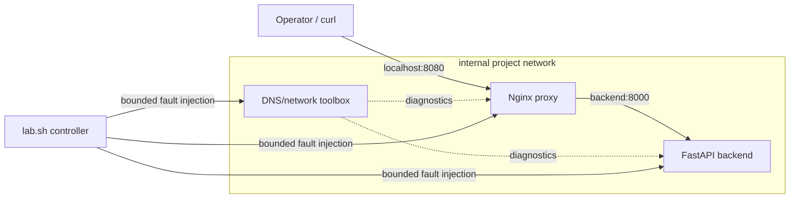
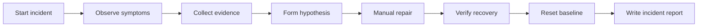

# Linux Production Troubleshooting & Incident Response Lab

A safe, disposable personal portfolio lab for practising Linux, container, network, Nginx, and application incident response. It represents hands-on learning—not production employment or a company environment.

## Architecture



All services use project-specific names, resource limits, an internal Docker network, dropped capabilities and `no-new-privileges`. There is no Docker socket mount, host network, privileged container, cloud deployment, or host firewall/SSH modification.

## Incident workflow



## Supported incidents

| ID | Incident | Mode |
|---|---|---|
| 01–09 | CPU, memory, disk, inode, process, permissions, port, env, DNS | Container |
| 10–11 | Incorrect route and true firewall port blocking | VM-only |
| 12–18 | Refusal, Nginx errors/config, restart, DNS, mapping | Container |
| 19 | SSH key/authentication failure | VM-only |
| 20 | Backup/log rotation failure | Container |

VM-only labs are intentionally separated because accurate routing, firewall blocking, and SSH/systemd exercises require a disposable VM. They are documented but never change the Windows/WSL host.

## Prerequisites and quick start

- Windows 11 with WSL2 and Docker Desktop, or Linux with Docker Engine
- Docker Compose v2, Bash, `curl`; optional `ShellCheck`

```bash
cp .env.example .env
docker compose up -d --build
curl http://127.0.0.1:8080/health/ready
./lab.sh list
./lab.sh start 13
./lab.sh hint 13
./lab.sh verify 13       # verifies the fault is observable
./lab.sh reset 13
```

Do not read `docs/SOLUTIONS.md` until you have recorded symptoms, evidence, and a hypothesis. `verify` confirms fault injection; after your manual fix, validate the health endpoint and then reset.

## Useful diagnostics

```bash
docker compose ps
docker compose logs --tail=100 proxy backend
docker compose exec toolbox nslookup backend
docker compose exec toolbox nc -vz backend 8000
docker compose exec backend ps aux
docker stats --no-stream
curl -v http://127.0.0.1:8080/
docker compose exec proxy nginx -t
```

## Validation

Run `./tests/run-safe-tests.sh`. CI runs Bash syntax, ShellCheck, Compose rendering, documentation inventory, and a lightweight baseline/closed-port smoke test. It deliberately does **not** run CPU, memory, disk, inode, routing, or SSH fault injection on shared runners. See `docs/VALIDATION_RESULTS.md` for dated, truthful results.

## Cleanup

```bash
./lab.sh reset-all
docker compose down --remove-orphans
docker volume rm linux-troubleshooting-lab-logs  # optional: deletes lab logs
```

Cleanup targets only resources with this project's explicit Compose project/name. Check with `docker compose ps` before removing the optional log volume.

## Documentation

- [Zero-to-working guide](docs/STEP_BY_STEP_GUIDE.md)
- [Architecture and security](docs/ARCHITECTURE_EXPLAINED.md)
- [20 hands-on labs](docs/HANDS_ON_LABS.md)
- [Solutions](docs/SOLUTIONS.md)
- [Interview preparation](docs/INTERVIEW_PREPARATION.md)
- [Incident report template](docs/INCIDENT_REPORT_TEMPLATE.md)

## Limitations

Containers share the host kernel, so this is not a full production Linux host. `systemctl` and `journalctl` are taught only in the optional systemd-enabled VM. Load is strictly bounded and intended for a developer laptop. No availability, performance, or production claims are made.
