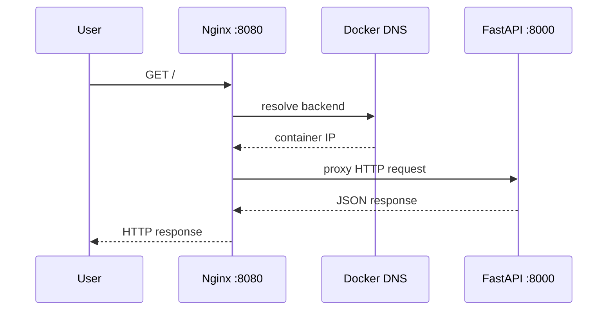

# Architecture Explained — شرح المعمارية

## المكونات الفعلية

`proxy` هو Nginx ويستقبل على `127.0.0.1:8080` فقط. `backend` هو FastAPI على port `8000` داخل network فقط. `toolbox` فيه `curl`, `dig`, `nslookup`, `ip`, `ping`, `ss`, و`nc`. الـnetwork اسمها `linux-troubleshooting-lab-net` و`internal: true`، لذلك الخدمات لا تملك Internet route مباشر.

## Fault injection

`lab.sh` يتحقق من ID ويمنع تشغيل incident ثانية قبل reset. `scripts/incident-action.sh` ينفذ fault محدود أو يضيف Compose override. الحالة تحفظ في `.lab-state/active`. الـreset يزيل فقط container الخاص بتعارض port ثم يعيد baseline.

## Resource boundaries

- backend: `0.50 CPU`, `128 MB`, `100 PIDs`, و`/tmp` حجمه `16 MB`.
- proxy/toolbox: CPU وmemory وPID limits أصغر.
- لا يوجد `privileged`, `NET_ADMIN`, host network أو Docker socket. الـproxy يأخذ فقط `CHOWN`, `DAC_OVERRIDE`, `SETUID`, و`SETGID` التي يحتاجها entrypoint الرسمي للتهيئة، بينما بقية capabilities محذوفة.
- incidents 10 و11 و19 VM-only حتى لا نمنح container صلاحية `NET_ADMIN` أو نزيّف routing/firewall/SSH.

## Security trade-offs

`cap_drop: ALL` و`no-new-privileges` يقللان blast radius، لكن Docker containers ليست security boundary مساوية لـVM. الـproxy يعمل من image رسمية pinned إلى minor tag، وليس digest؛ digest pinning أفضل لسلسلة توريد production. Port منشور على loopback فقط، لذلك غير متاح على LAN افتراضيًا.
